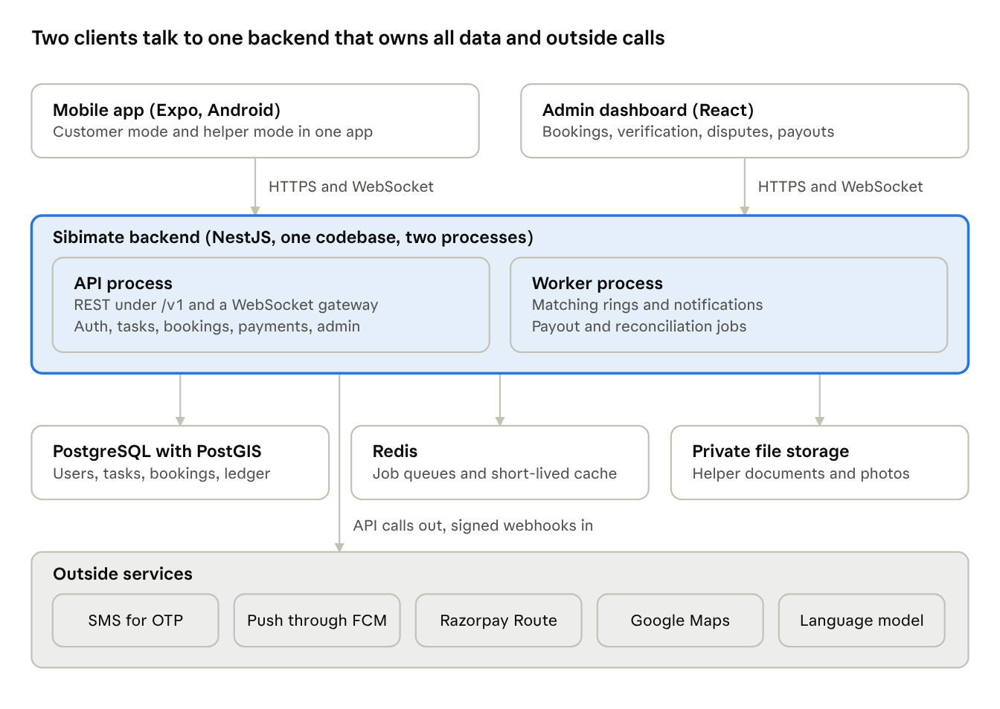
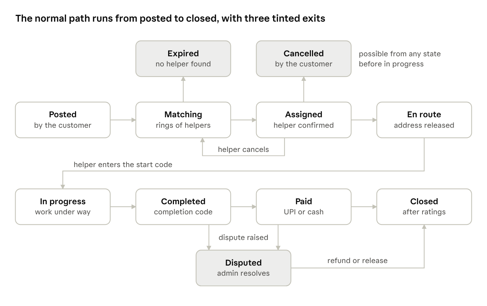

# Sibimate system design and application architecture

Nov 20, 2026 · @Kunal Boyal

## Scope and settled decisions

Version 1 is one Android app with customer and helper modes, one web admin dashboard and one API. It is voice first and serves any everyday task, skilled or unskilled, wherever a helper is near the customer, with marketing starting in Mansarovar, Jaipur. The choices below come from your three planning documents and the designed screens.

| Decision     | Choice for version 1                                                                                                                                                                                     |
|--------------|----------------------------------------------------------------------------------------------------------------------------------------------------------------------------------------------------------|
| Service area | No area limit in the app: it reads the phone's location and works wherever helpers are nearby.                                                                                                           |
| Task scope   | Any task. The customer speaks the problem, AI rewrites it as clear task details and picks the category, and the customer accepts or rejects those details                                                |
| Skilled work | Included; nothing is excluded by category. Every helper carries a skilled or unskilled tag, and any helper can bid for a skilled job. Only helpers verified as skilled show the skilled tag on their bid |
| Booking      | Instant and scheduled; no fixed prices. The customer names their own price, and each helper accepts it or quotes their own                                                                               |
| Payment      | UPI in the app, with cash to the helper as a controlled fallback                                                                                                                                         |
| Helpers      | Independent individuals aged 18 or older who choose their own hours                                                                                                                                      |
| Revenue      | Commission on completed tasks, 12% to start and editable from the admin dashboard; no separate customer fee                                                                                              |
| Platform     | Android first, built with React Native and Expo so iOS can follow                                                                                                                                        |
| Languages    | English and Hindi for now and Indian regional languages for the future                                                                                                                                   |

Left out of version 1: business accounts, helper subscriptions, loyalty points, dynamic pricing, multi-city management and automated customer support.

## System overview

The mobile app and the admin dashboard talk only to the Sibimate backend, and the backend alone reads the data stores and calls outside services.

The backend is one NestJS codebase started as two processes. The API process answers requests and holds WebSocket connections. The worker process takes jobs from Redis queues: matching rings, notifications, payout transfers and the nightly reconciliation. A slow outside service therefore delays a job and never a customer's request.

## Repository layout

All code lives in one TypeScript monorepo so the app, the dashboard and the API share types and validation rules. It uses pnpm workspaces with Turborepo for builds.

| Path                | Holds                                                                                     |
|---------------------|-------------------------------------------------------------------------------------------|
| apps/api            | NestJS application, run as two processes: api for requests and worker for background jobs |
| apps/mobile         | Expo app with customer and helper modes                                                   |
| apps/admin          | React and Vite admin dashboard                                                            |
| packages/shared     | Request and response schemas (zod), the task state machine, category and error constants  |
| packages/api-client | Typed client generated from the API's OpenAPI document                                    |
| packages/ui-tokens  | Colours, type and spacing taken from the design canvas                                    |
| infra               | Docker Compose for local PostgreSQL with PostGIS and Redis, plus deploy configuration     |
| docs                | This architecture and short decision records                                              |

The API is a modular monolith. Its modules are auth, users, helpers, categories, tasks, matching, bookings, payments, payouts, reviews, disputes, notifications, interpretation and admin. Each module owns its tables and exposes a service to the others, which keeps a later split into services possible without paying for it now.

## Data model

PostgreSQL with the PostGIS extension holds everything, and every location is a geography(Point, 4326) column with a GiST index. All tables carry id (UUID), created_at and updated_at.

| Table               | Key columns                                                                                                                                                                                                                    | Notes                                                                                                                        |
|---------------------|--------------------------------------------------------------------------------------------------------------------------------------------------------------------------------------------------------------------------------|------------------------------------------------------------------------------------------------------------------------------|
| users               | phone (unique), name, language, roles, status                                                                                                                                                                                  | One account per phone; roles are customer and helper                                                                         |
| helper_profiles     | user_id, skill_tag, skills, verification_level, status, photo_key, payout_account_ref, rating_avg, completed_count, cancelled_count                                                                                            | Skill tag is skilled or unskilled, and skills lists a skilled helper's trades. Status is pending, active, paused or rejected |
| helper_documents    | helper_id, kind, storage_key, review_status, reviewed_by                                                                                                                                                                       | Image stays in private storage; no ID number is stored                                                                       |
| helper_availability | helper_id, is_online, last_location, radius_m, seen_at                                                                                                                                                                         | One row per helper, updated while online                                                                                     |
| task_categories     | slug, name, requires_skilled, skill, source, review_status, risk_level, min_verification_level, active                                                                                                                         | The list AI assigns from. AI can propose a new category, which an admin approves or merges                                   |
| tasks               | customer_id, category_id, description_raw, description_refined, requires_skilled, details (jsonb), pickup_point, drop_point, address_enc, schedule_at, customer_price, search_radius_m, helpers_needed, payment_method, status | Exact address is encrypted and released only after confirmation                                                              |
| task_offers         | task_id, helper_id, price, eta_min, status, ring                                                                                                                                                                               | One row per helper notified; holds the helper's own price when they quote one                                                |
| bookings            | task_id, helper_id, agreed_price, commission_rate, commission, start_code_hash, completion_code_hash, started_at, completed_at, status                                                                                         | Created when a helper is confirmed; the commission rate in force is copied here                                              |
| task_events         | task_id, from_status, to_status, actor_id, actor_role, meta                                                                                                                                                                    | Append-only history of every status change                                                                                   |
| payments            | booking_id, method, timing, released_at, gateway_order_id, gateway_payment_id, amount, status                                                                                                                                  | One per booking; method is upi or cash, and timing is at confirmation or after the job                                       |
| payouts             | booking_id, helper_id, amount, gateway_transfer_id, status                                                                                                                                                                     | Helper share of an online payment                                                                                            |
| commission_ledger   | helper_id, booking_id, amount_due, settled_at                                                                                                                                                                                  | Commission owed on cash tasks                                                                                                |
| reviews             | booking_id, author_id, subject_id, rating, comment                                                                                                                                                                             | Both sides rate after completion                                                                                             |
| disputes            | booking_id, raised_by, reason, status, resolution, refund_amount                                                                                                                                                               | Worked from the admin dashboard                                                                                              |
| devices             | user_id, push_token, platform, last_seen_at                                                                                                                                                                                    | Push targets                                                                                                                 |
| admin_users         | email, password_hash, totp_secret_enc, role                                                                                                                                                                                    | Separate from app users                                                                                                      |
| audit_log           | admin_id, action, entity, entity_id, meta                                                                                                                                                                                      | Every admin write and every document view                                                                                    |
| commission_rules    | category_id (null for the default), rate, effective_from, changed_by                                                                                                                                                           | Edited from the admin dashboard; old rows are kept as history                                                                |

Money is stored in paise as integers. Statuses are PostgreSQL enums that mirror the state machine in packages/shared, so the database rejects a status the code does not know.

## Task lifecycle

Every task follows one state machine; instant and bidding flows differ only in how the helper is chosen during matching. The machine lives in packages/shared, and the API refuses any move it does not list.

| Move                                      | Triggered by                                                            | Condition                                                                      |
|-------------------------------------------|-------------------------------------------------------------------------|--------------------------------------------------------------------------------|
| draft to posted                           | Customer                                                                | The request passes the safety rules and the customer has named a price         |
| posted to matching                        | System                                                                  | At once for instant tasks; ahead of the slot for scheduled ones                |
| matching to assigned                      | Helper accepts the customer's price, or customer picks a helper's quote | First valid claim wins, in one atomic update                                   |
| matching to expired                       | System                                                                  | No helper after the last search ring; customer is offered a schedule or quotes |
| assigned to en route                      | Helper                                                                  | Helper starts travelling; exact address is released                            |
| en route to in progress                   | Helper                                                                  | Start code from the customer matches                                           |
| in progress to completed                  | Helper                                                                  | Completion code from the customer matches                                      |
| completed to paid                         | Release of a payment made early, payment webhook, or helper for cash    | Amount matches the agreed price                                                |
| paid to closed                            | System                                                                  | Rating window ends                                                             |
| assigned or en route back to matching     | Helper cancels                                                          | Task is matched again and the cancellation is counted                          |
| any state before in progress to cancelled | Customer                                                                | Allowed without a reason                                                       |
| completed or paid to disputed             | Customer or helper                                                      | Raised within the dispute window; an admin resolves it                         |

Each move writes a row to task_events and emits one domain event. Notifications, the real-time channel and the admin dashboard all read that event instead of polling.

## Matching engine

Matching is a background job that searches for eligible helpers in widening rings and stops at the first valid claim. The ring sizes and waits below are the starting values from your strategy plan and sit in configuration. There is no service-area boundary: a task posted from any location is matched if eligible helpers fall inside the rings.

1.  Filter for eligibility: the helper is online and active, holds the verification level the category needs, has no other job within three hours of the task's time, and has seen the app in the last few minutes. Helpers with no other job are notified first. A helper busy on one job can still be shown and take a task for later in the day, and can hold several jobs as long as they are three hours apart; a job not yet finished counts as happening at its slot, or now once that has passed. They travel to one job at a time. A helper with bids open on other tasks can still bid on any task that is open for bids.

2.  Search ring one with ST_DWithin at 2 km from the pickup point, also respecting each helper's own radius.

3.  Rank the ring by distance, completion rate, cancellation rate and rating, then notify the top ten by push.

4.  If nobody claims the task in 2 minutes, widen to 5 km; after 3 more minutes, widen to 8 km. The customer can also increase or decrease the search area themselves while the task is matching. Their choice replaces the current ring at once, and automatic widening never goes past a radius the customer has reduced.

5.  Accepting the customer's price: the first helper to accept wins through a single conditional update on the task row, so two helpers can never both be assigned.

6.  Quoting a different price: a helper can instead send their own price, and the customer picks a quote or waits for more. The platform sets no fixed price and no price limits. When a helper is confirmed on one task, their open bids within three hours of it are withdrawn automatically; bids for other times stay open. Skilled jobs are open to every eligible helper, and an acceptance there counts as a quote at the customer's price, so the customer always chooses; each quote shows whether the helper carries the skilled tag, and the customer chooses.

7.  If the last ring ends with no helper, the task expires, the customer is offered a scheduled slot or the chance to raise their price, and the task appears in the admin unmatched queue.

Each ring is a delayed BullMQ job keyed by task, so a restart never notifies a helper twice. Helpers send their location about once a minute while online, and only the latest point is kept.

## API design

The API is REST over HTTPS under /v1, with JSON bodies and a bearer token. A WebSocket channel carries live updates.

| Area               | Main endpoints                                                                                                                                                                                       |
|--------------------|------------------------------------------------------------------------------------------------------------------------------------------------------------------------------------------------------|
| Auth               | POST /auth/otp/request, POST /auth/otp/verify, POST /auth/refresh, POST /auth/logout                                                                                                                 |
| Profile            | GET /me, PATCH /me, POST /me/devices                                                                                                                                                                 |
| Task understanding | POST /tasks/interpret takes a voice recording or typed text and returns the AI-written task details for the customer to accept or reject                                                             |
| Tasks, customer    | POST /tasks, GET /tasks, GET /tasks/:id, POST /tasks/:id/cancel, GET /tasks/:id/offers, POST /tasks/:id/offers/:offerId/accept                                                                       |
| Tasks, helper      | GET /helper/tasks/nearby, POST /helper/tasks/:id/accept, POST /helper/tasks/:id/quote, POST /helper/tasks/:id/decline                                                                                |
| Bookings           | POST /bookings/:id/en-route, POST /bookings/:id/start with the start code, POST /bookings/:id/complete, GET /bookings/:id/completion-code, POST /bookings/:id/review, POST /bookings/:id/dispute     |
| Helper account     | POST /helper/profile, POST /helper/documents, PUT /helper/availability, PUT /helper/location, GET /helper/earnings                                                                                   |
| Payments           | POST /bookings/:id/payment/order, POST /bookings/:id/payment/cash-received, POST /webhooks/razorpay                                                                                                  |
| Admin              | /admin/overview, /admin/bookings, /admin/helpers, /admin/disputes, /admin/payouts, /admin/categories, plus /admin/settings/commission for commission rates, each with list, detail and action routes |

Conventions:

- Validation uses the zod schemas in packages/shared, so the app and the API reject the same inputs.

- Errors return { code, message, details } with a stable code the app can translate into Hindi or English.

- Task creation, quotes and payment calls require an Idempotency-Key header, so a retry on a weak connection never creates a duplicate.

- Lists use cursor pagination.

- The WebSocket gateway has one room per task and one per helper. It carries status changes, new offers, and helper location while a booking is active.

- Push notifications cover the same events when the app is in the background.

## Identity, roles and helper verification

A person signs in with a mobile number and a one-time code, and one account serves both modes. Every account is a customer; the helper role is added when an admin approves the helper profile.

- Sessions use a 15-minute access token and a rotating refresh token tied to the device.

- OTP requests are rate-limited per phone and per device, and codes are stored hashed.

- The Hire and Earn switch in the app is a view setting. The API checks the role on every helper endpoint.

- Admins have their own table and sign in on the dashboard with email, password and an authenticator code.

- Admin roles are owner, operations, verifier and finance. Only verifiers can open identity documents, and each view is written to the audit log.

The category a task falls in sets the verification level a helper needs. Each helper also carries a skilled or unskilled tag, chosen at onboarding and confirmed by a verifier, and skilled helpers list their trades. The tag is a badge the customer sees and does not restrict work: an unskilled helper can bid for a skilled job, without the tag.

| Level       | Checks                                                                            | Tasks allowed                                                                  |
|-------------|-----------------------------------------------------------------------------------|--------------------------------------------------------------------------------|
| Basic       | Mobile OTP, identity document, age 18 or older                                    | Low-risk tasks in public places: errands, parcel drops, carrying luggage       |
| Verified    | Basic, plus photo match, payout account, emergency contact and safety orientation | Household and customer-facing tasks, including entering homes                  |
| Specialised | Verified, plus proof of qualification                                             | Same tasks as Verified; this level is what earns the skilled tag shown on bids |

A helper sees only the pickup area and distance before confirmation. The exact address and the in-app chat and call button are released when the booking is confirmed.

## Payments and payouts

Online payments go through a licensed payment aggregator that splits each payment between the helper and Sibimate, so Sibimate never holds customer money in a wallet of its own. The design assumes [Razorpay Route](https://razorpay.com/docs/payments/route/), which splits payments to Linked Accounts and reverses a transfer when a payment is refunded.

Online flow:

1.  When a helper is approved, the API registers them as a Linked Account and stores only the returned account reference.

2.  The customer chooses when to pay: when the helper is confirmed, or after the job. In both cases the API creates an order for the agreed price and the app opens UPI checkout.

3.  The payment webhook, verified by signature, marks the payment captured. If the customer paid early, the helper is told at once that the payment is received and held until the job is done.

4.  When the job is done, the customer gives the helper a completion code, and entering it completes the booking. That releases the money: the API transfers the agreed price minus commission to the helper's Linked Account, using the rate copied to the booking when the helper was confirmed.

5.  Settlement webhooks update the payout row that the helper's earnings screen reads.

Cash fallback:

- The helper confirms cash received, and the customer gets a receipt in the app.

- The commission is written to commission_ledger as an amount the helper owes.

- Dues are deducted from the helper's next online payouts. Above a set limit of unpaid dues, the helper is offered only online-payment tasks until it clears.

If a customer does not share the completion code, the helper raises a dispute and an admin decides whether to release or refund the held payment. Refunds are issued from the admin dashboard and reverse the helper transfer in the same call. A nightly job compares gateway records with the payments and payouts tables and lists any mismatch for the finance role.

Payment fees, GST on the commission and the aggregator contribution under the Code on Social Security are separate lines in the per-task ledger, so the contribution margin your plan tracks can be read directly.

The commission rate is a setting in the admin dashboard. The owner or finance role edits the default rate and can set a different rate for a category. A change applies to bookings confirmed after it, is written to the audit log, and never alters a booking already under way. Helpers see the current rate and their net amount before they accept or quote.

## Voice-first task understanding with AI

The customer speaks the problem, and AI turns it into clear task details with a category. The customer accepts or rejects those details before anything is posted. The model never approves a helper or sets the final price.

1.  The home screen opens on the microphone and prompts the customer to say what they need, in Hindi, English or a mix. Typing stays available.

2.  The app sends the recording to POST /tasks/interpret, where a speech-to-text step produces the transcript.

3.  The model rewrites the transcript as a clear task: a title, an improved description, the category, whether it is a skilled job, helpers needed, estimated minutes, requirements and risk flags. It asks one follow-up question when a key detail is missing.

4.  The model picks the category from the current list. When nothing fits, it proposes a new one; the task carries it as a provisional category, and an admin approves or merges it later.

5.  The API validates the output against a schema. Fixed rules then attach the verification level, and block requests that are illegal or unsafe.

6.  The customer sees the task details and accepts or rejects them. Rejecting lets them speak again or correct a field; accepting posts the task.

Low confidence, a risk flag or a provisional category marks the task for admin review. If the model is unavailable, the customer types the task and picks skilled or unskilled, and an admin assigns the category.

The model sits behind a TaskInterpreter interface, so the provider can change without touching the rest of the code. Phone numbers and addresses are stripped from the text before it leaves the API.

Because voice and AI are now the main way to post a task, this module is built in milestone 1. The transcript, the AI version and the customer's decision are stored so the prompts can be improved from real requests; the recording is deleted once it is transcribed.

## Mobile app and admin dashboard

Each screen on the [design canvas](https://claude.ai/artifact/GbhkFnT6h7cscU5MRK9Qij) maps to one route and a small set of API calls. Colours, type and spacing come from packages/ui-tokens, so both clients match the designs.

| Designed screen       | Client route                       | API it uses                                                  |
|-----------------------|------------------------------------|--------------------------------------------------------------|
| Welcome and sign in   | mobile: /(auth)/welcome            | /auth/otp/request, /auth/otp/verify                          |
| Home                  | mobile: /(hire)/index              | /tasks/interpret, /tasks?status=active                       |
| Confirm task          | mobile: /(hire)/task/new           | /tasks                                                       |
| Helper offers         | mobile: /(hire)/task/\[id\]/offers | /tasks/:id/offers, task room on the WebSocket                |
| Task tracking         | mobile: /(hire)/task/\[id\]        | /tasks/:id, task room, payment order                         |
| Nearby tasks          | mobile: /(earn)/index              | /helper/tasks/nearby, /helper/availability, /helper/location |
| Task detail and quote | mobile: /(earn)/task/\[id\]        | /helper/tasks/:id/accept, /helper/tasks/:id/quote            |
| Earnings              | mobile: /(earn)/earnings           | /helper/earnings                                             |
| Admin overview        | admin: /                           | /admin/overview                                              |
| Admin bookings        | admin: /bookings                   | /admin/bookings, assign, widen search, refund                |
| Helper verification   | admin: /helpers                    | /admin/helpers, approve, request details, reject             |

Mobile app:

- Expo Router gives file-based navigation, with separate route groups for sign-in, Hire mode and Earn mode.

- TanStack Query holds server data and caches it for weak connections. A small Zustand store holds the session, language and current mode.

- Location, notifications and maps use expo-location, expo-notifications and react-native-maps.

- Remote push on Android needs a development build made with EAS and FCM credentials, as the [Expo push setup guide](https://docs.expo.dev/push-notifications/push-notifications-setup/) describes.

- All copy sits in English and Hindi translation files from the first commit.

Admin dashboard:

- React with Vite, React Router, TanStack Query and TanStack Table, served as static files at admin.sibimate.com.

- The dashboard subscribes to the same domain events as the app, so the unmatched queue updates without a refresh.

Screens still to design before their modules are built: helper onboarding and document upload, payment and receipt, rating, dispute form, and the admin pages for disputes, payouts, customers, categories, and commission settings. The home and confirm screens also need a revision for the voice-first flow and the accept or reject step, and the tracking screen needs the pay-now choice and the completion code.

## Infrastructure, security and privacy

The pilot runs on a small AWS footprint in the Mumbai region, sized for one locality and built from containers so it can grow without a rewrite.

| Piece           | Pilot setup                                                                                        |
|-----------------|----------------------------------------------------------------------------------------------------|
| API and worker  | Two containers from one image; a single small host is enough for the pilot                         |
| Database        | Managed PostgreSQL with PostGIS and daily backups                                                  |
| Redis           | Queues and short-lived cache, on the same host at first                                            |
| File storage    | Private S3 bucket with server-side encryption; documents are read through short-lived signed links |
| Admin dashboard | Static files behind a CDN at admin.sibimate.com                                                    |
| API address     | api.sibimate.com                                                                                   |
| Public site     | sibimate.com                                                                                       |
| Environments    | Local with Docker Compose, staging, production                                                     |
| Delivery        | GitHub Actions for lint, tests and container builds; EAS Build for the Android app                 |
| Secrets         | Parameter store on the host platform, never in the repository                                      |
| Monitoring      | Structured logs, error tracking, and alerts on queue delay and failed webhooks                     |

Security and privacy rules built in from the first milestone:

- Collect the minimum: phone, name, location while a task is active, and the documents verification needs. No identity number is stored.

- Exact addresses are encrypted in the database and shown only to the confirmed helper and to admins.

- Location tracking runs only while a helper is online or on a booking, and history is not kept after the booking closes.

- Every admin write and every document view lands in the audit log.

- Users can request deletion of their account; a job removes or anonymises their data once open bookings and legal retention periods end.

- Consent and a plain-language notice appear at sign-up in both languages.

The substantive duties of the DPDP framework on notice, consent and user rights apply from 13 May 2027 under the phased commencement described in this [AZB & Partners update](https://www.azbpartners.com/bank/update-indias-digital-personal-data-protection-framework-comes-into-effect/). Building these rules in now avoids a retrofit, and your lawyer should confirm the exact obligations.

## Build order

The code is built in six milestones, and the first two are enough to run the manual pilot your plan puts before the full MVP. Each milestone ends with something you can use in Mansarovar.

| Milestone                   | Delivers                                                                                                                                                                                                                   | Done when                                                                     |
|-----------------------------|----------------------------------------------------------------------------------------------------------------------------------------------------------------------------------------------------------------------------|-------------------------------------------------------------------------------|
| 0\. Foundations             | Monorepo, CI, local database, shared schemas, design tokens, OTP sign-in on app and API                                                                                                                                    | You can sign in on a phone against staging                                    |
| 1\. Post and assign by hand | Customer speaks or types a task, AI writes the details and picks the category, and the customer accepts or rejects them; admin sees it and assigns a helper; helper accepts, starts with the code and completes; cash only | A real task runs end to end with you assigning it from the dashboard          |
| 2\. Matching and offers     | Helper availability and location, ring search, instant accept, quotes, live tracking, unmatched queue                                                                                                                      | A task finds a helper without admin action                                    |
| 3\. Payments                | UPI checkout, split to helper, commission settings in the admin dashboard, cash commission ledger, refunds, earnings screen, reconciliation job                                                                            | A paid task shows the right amounts for customer, helper and Sibimate         |
| 4\. Trust and operations    | Helper onboarding with the skilled or unskilled tag, verification levels, ratings, disputes, admin overview metrics, audit log                                                                                             | A new helper goes from application to first task with no manual database work |
| 5\. Launch                  | Prompt tuning from real requests, review of categories AI proposed, Hindi copy review, Play Store closed test, monitoring and alerts                                                                                       | The pilot build is installed by the first customers and helpers               |

Milestones 0 and 1 are the first code I would push to the repository after you approve this document.

## Open questions

All but the legal review were decided on 20 November 2026; [decisions.md](../decisions.md) records each answer and what it still needs before launch.

- [x] Payment timing: the customer pays when the helper is confirmed or after the job; early money is held until the completion code.
- [x] Payment provider: Razorpay Route, once Razorpay confirms helpers can be Linked Accounts.
- [x] Cash dues limit: ₹500, editable from the dashboard.
- [x] SMS provider: MSG91, after DLT sender and template registration.
- [x] Model and speech-to-text: OpenAI for both.
- [x] Hosting: AWS, Mumbai.
- [x] Cancellation: ₹30 to the helper when the customer cancels after the helper has set off, editable from the dashboard.
- [x] Time limits: 48-hour dispute window, 30-minute completion-code wait, both editable.
- [ ] Legal review: still needed, with a lawyer.
- [x] GitHub repository: github.com/kunal-boyal/sibimate.
- [x] Skilled tag: a certificate or licence, or photos of past work with a checked reference.

## Sources

- [Razorpay Route documentation](https://razorpay.com/docs/payments/route/) for split payments, Linked Accounts, transfers and reversals

- [Expo push notifications setup](https://docs.expo.dev/push-notifications/push-notifications-setup/) for the Android build and FCM requirement

- [AZB & Partners, India's DPDP framework comes into effect](https://www.azbpartners.com/bank/update-indias-digital-personal-data-protection-framework-comes-into-effect/) for the phased commencement dates

- Your three planning documents: the Any-Work opportunity review, the business strategy and launch plan, and the Jaipur market plan

- [Sibimate design canvas](https://claude.ai/artifact/GbhkFnT6h7cscU5MRK9Qij) for the screens
